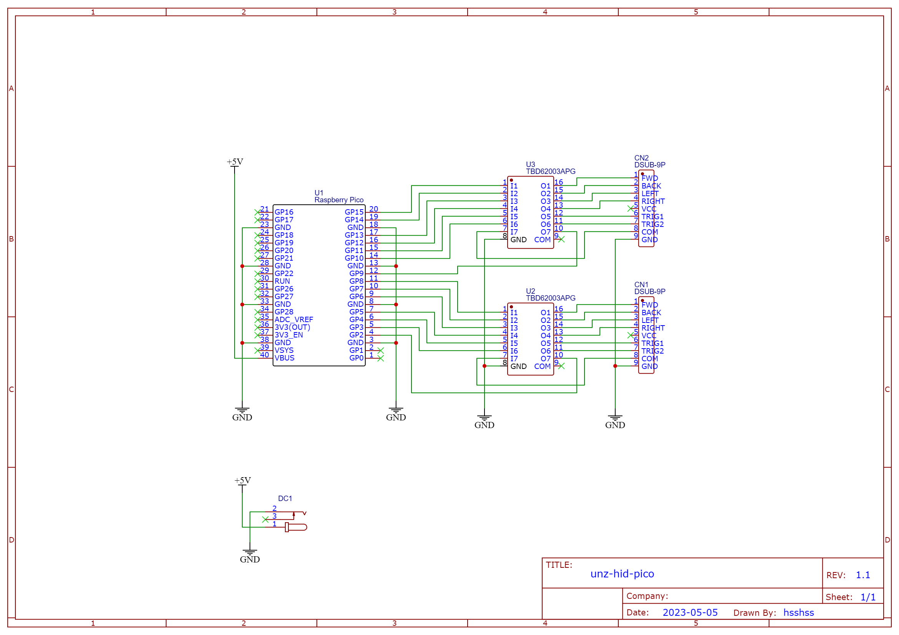

# Overview

This project is an adapter to use USB HID with FM TOWNS / MSX using Raspberry Pi Pico.

# Limitation

Gamepad support is currently only available for PS4/PS5 controllers.

# Hardware



### Notes

- USB devices should be connected to the Raspberry Pi Pico using an OTG cable.
- Transistor array IC can be replaced by discrete transistors and resistors.

# Building

```bash
git clone https://github.com/hsshss/unz-hid-pico.git
cd unz-hid-pico
docker build -t unz-hid-pico-builder .
docker run --rm -v ${PWD}:/app -t unz-hid-pico-builder sh -c "mkdir -p build && cd build && cmake .. && make"
```

# Flashing

1. Disconnect all connectors
2. While holding down the BOOTSEL button, connect to a PC with a USB cable
3. A USB Mass Storage Device named `RPI-RP2` will be mounted
4. Drag and drop the `unz-hid-pico.uf2` file onto `RPI-RP2`